# Détecteur de publicité ESP32

**Fonctionnel · testé sur un téléviseur Smart TV TCL (Android TV / Google TV)**

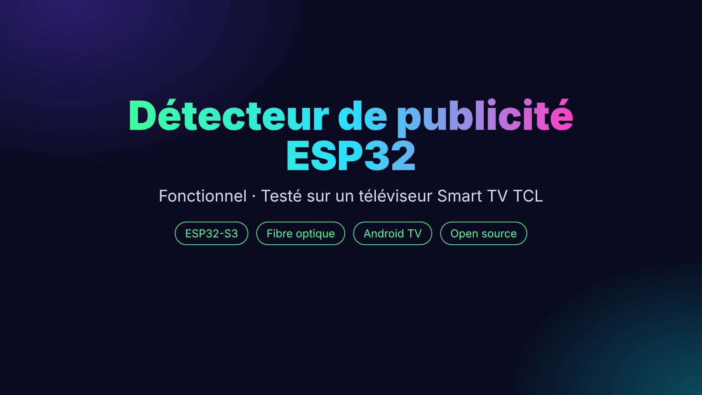

Un détecteur de publicité fait maison. La carte écoute la télévision, reconnaît les publicités qu'elle a déjà
entendues, et **baisse le son tout seul par le Wi-Fi**. À la fin de la coupure publicitaire, elle remonte le
volume en douceur, jusqu'au niveau d'avant. Aucune télécommande à toucher.

▶ Vidéo de présentation : *(lien YouTube à ajouter)*

| Accueil de la carte | Captation | Journal | Module optique |
|---|---|---|---|
| 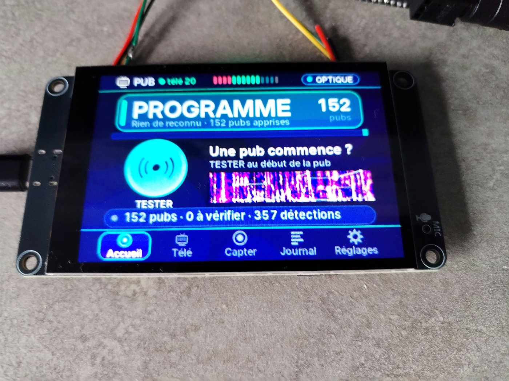 | 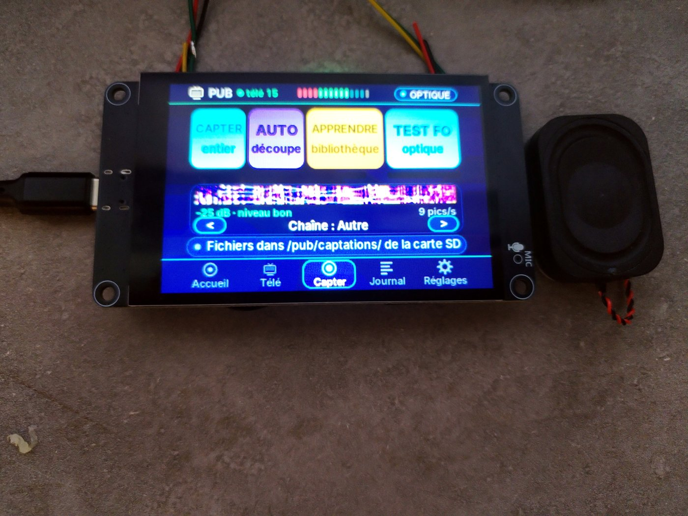 | 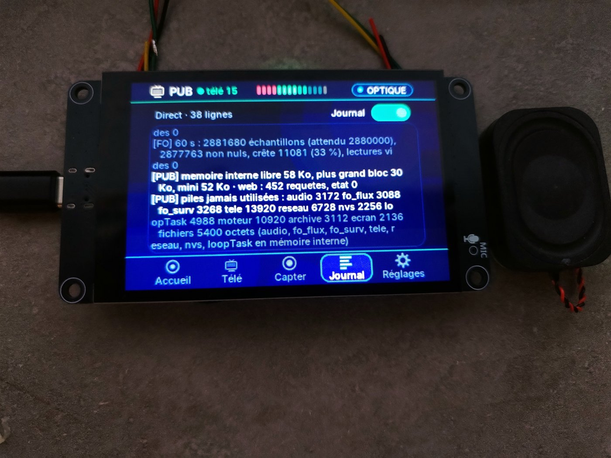 | 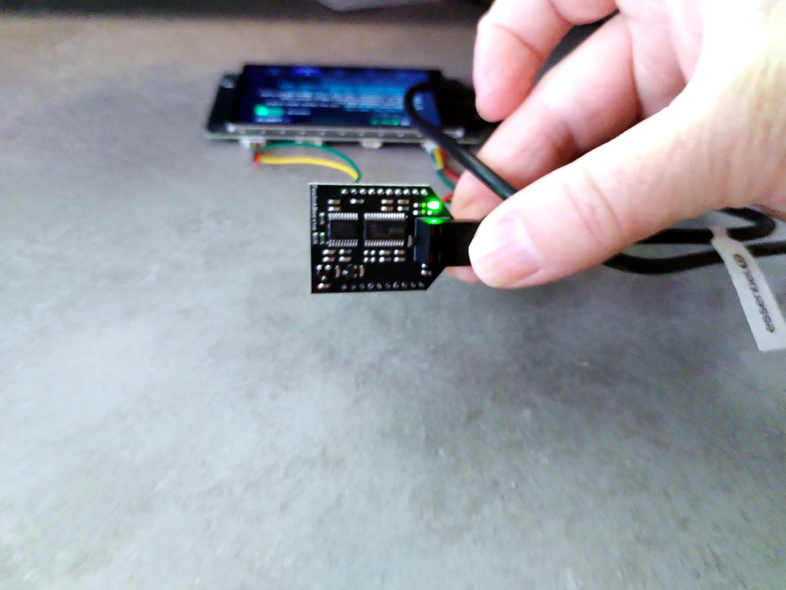 |

## Fonctions

- **Reconnaissance des publicités par empreinte audio** (à la manière de Shazam), en environ 2 secondes.
- **Deux façons d'écouter** : le micro de la carte, ou la **sortie optique** de la télévision (module TOSLINKBee).
- **Commande du volume par le Wi-Fi** (protocole *Android TV Remote*, comme l'application du téléphone).
- **Son baissé pendant les publicités** (volume réglable, 1 conseillé), puis **remontée progressive par paliers**
  jusqu'au volume d'avant.
- **Apprentissage** : bouton **TESTER** au début d'une publicité, ou mode **APPRENDRE** pendant une coupure :
  la carte découpe et apprend seule les nouvelles publicités ; les cas douteux sont à valider.
- **Portail web** intégré (téléphone ou ordinateur) : état en direct, spectre du son, 4 préréglages,
  validation des publicités, sauvegardes, surveillance de la mémoire.
- **Logiciel PC** (`outils/gestion_pubs.py`) : écouter, renommer, découper, trier les publicités.

### Les écrans de la carte

| Accueil | Télé | Capter |
|---|---|---|
| 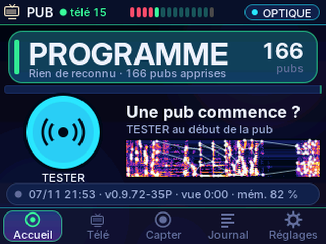 | 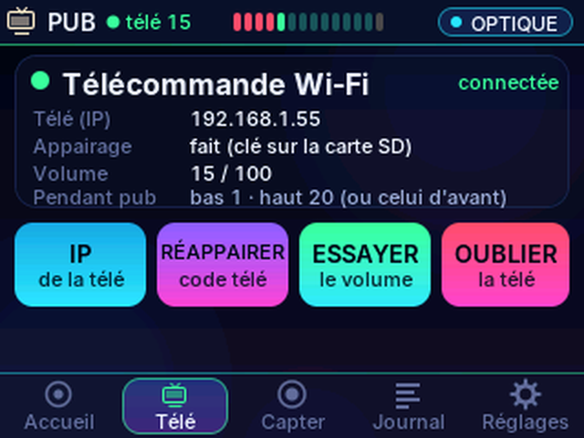 | 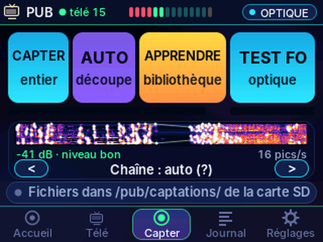 |
| **Journal** | **Réglages · Profils** | **Réglages · Son télé** |
| 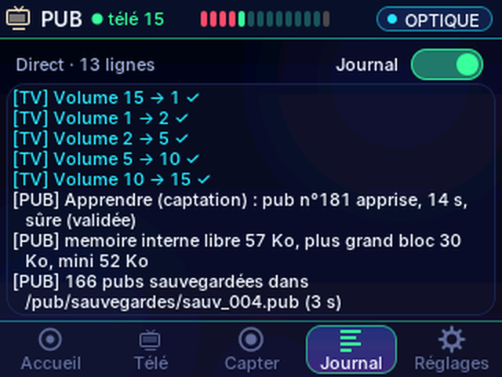 | 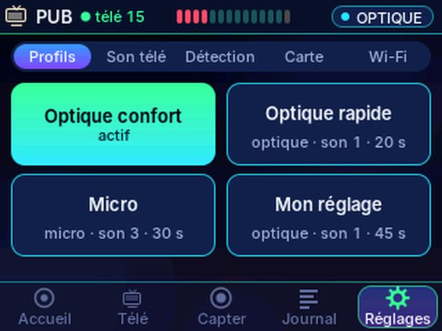 | 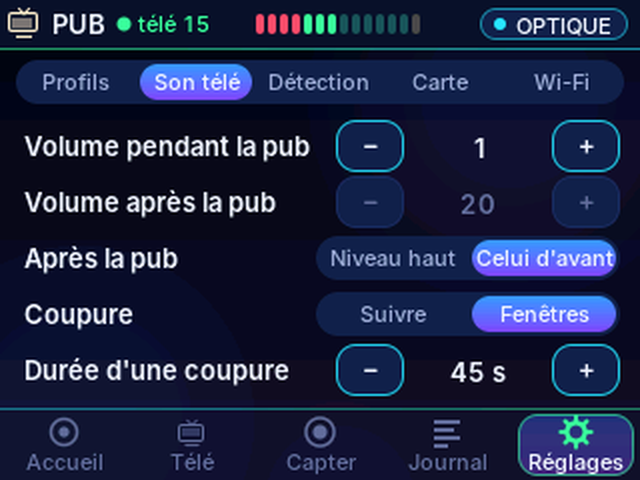 |

### Le portail web

| Accueil (en marche) | Pendant une publicité | Captation |
|---|---|---|
| 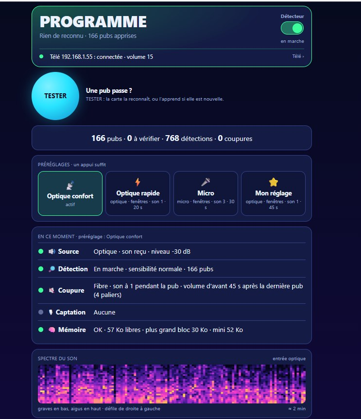 | 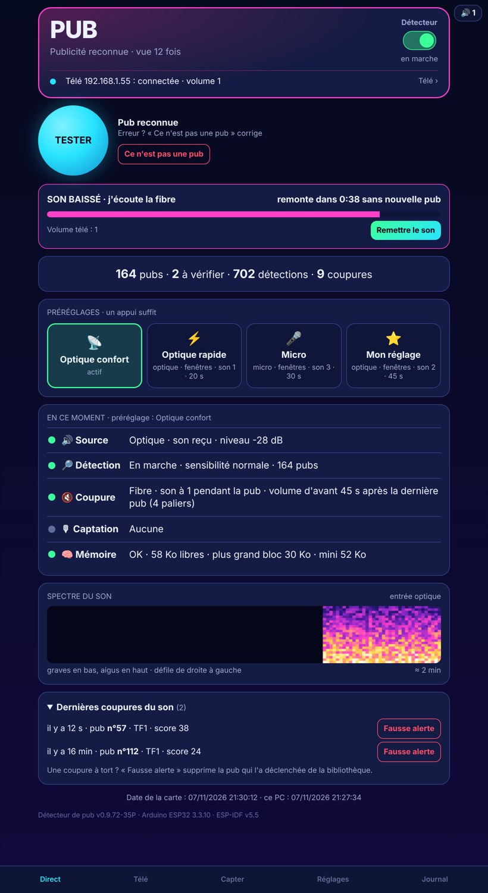 | 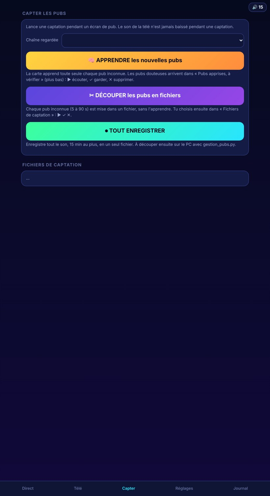 |

### Deux façons de couper le son

| Avec la fibre optique : la carte suit les publicités | Avec le micro : coupure par fenêtres et réécoute |
|---|---|
| 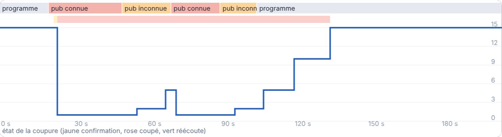 | 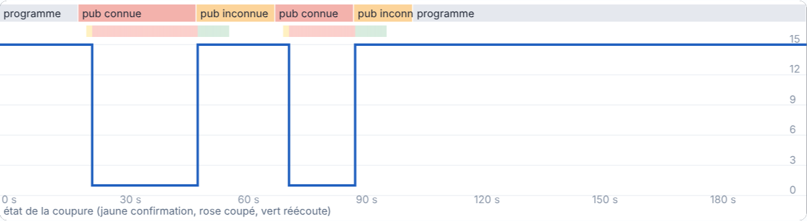 |

- **Fibre optique** : la carte entend la télévision même son baissé. Le son reste à 1 tant que les publicités
  s'enchaînent, puis remonte par paliers (10 %, 30 %, 65 %) jusqu'au volume d'avant.
- **Micro** (télé sans sortie optique) : son baissé, la carte n'entend plus la télé. Le son reste bas pendant la
  « durée d'une coupure », remonte, la carte réécoute quelques secondes ; encore une publicité → nouvelle coupure.

### Les bons réglages

| Réglage | Conseil |
|---|---|
| Préréglage | « Optique confort » (fibre) ou « Micro » : un appui |
| Volume pendant la publicité | **1** (à 0, certaines télés coupent aussi la sortie optique) |
| Après la publicité | revenir au volume d'avant |
| Coupure | par fenêtres |
| Durée d'une coupure | 20 à 45 s |
| Réécoute (micro) | 8 s |
| Sensibilité | normale |
| Source du son | micro ou entrée optique |

### Le logiciel PC

| Accueil (2 modes) | Captations | Comparer A / B |
|---|---|---|
| 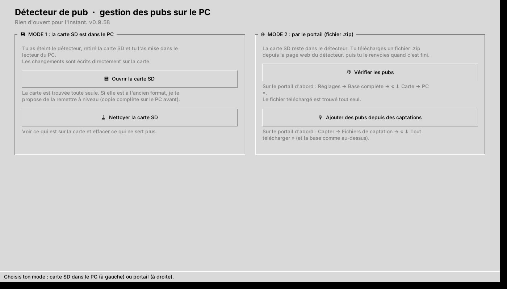 | 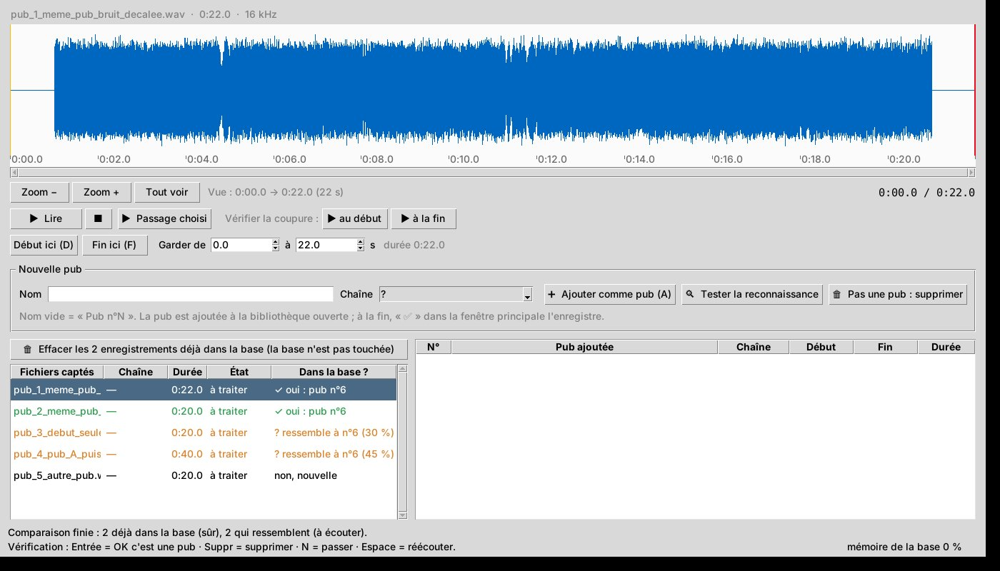 | 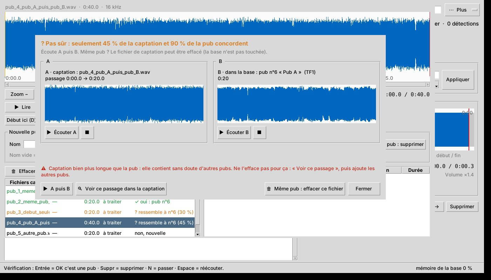 |

## Matériel

| Élément | Détail |
|---|---|
| Carte | LCDwiki **ES3C35P** « 3.5inch ESP32-S3 Display » |
| Processeur | ESP32-S3 N16R8 : 2 cœurs à 240 MHz, 16 Mo de flash, 8 Mo de PSRAM (OPI) |
| Écran | 3,5" IPS 480×320, contrôleur ST77922 (QSPI), tactile ST7123 |
| Son | codec ES8311, micro, haut-parleur |
| Stockage | carte microSD (base des publicités, sons, captations) |
| Entrée optique (option) | module **TOSLINKBee** V1.0 (DIR9001), sortie I2S |
| Télévision | Android TV / Google TV sur le même réseau Wi-Fi (testé : TCL) |

### Câblage du module TOSLINKBee (option)

Trous comptés depuis le côté opposé à la prise optique, module vu côté puces :

| TOSLINKBee | ES3C35P |
|---|---|
| Gauche 1er trou : J2-1 +5 V (entrée) | 5V du connecteur série P2 |
| Gauche 5e trou : J2-5 +3,3 V (sortie du module) | **ne rien brancher** |
| Gauche 6e trou : J2-6 GND | GND |
| Droite 1er trou : J1-10 LRCK | IO46 |
| Droite 2e trou : J1-9 SD (données) | RXD = GPIO44 |
| Droite 3e trou : J1-8 BCK | IO45 |

La télévision doit être réglée en **sortie optique PCM** (pas Dolby / Bitstream). Sur certaines télés (dont la TCL),
un volume à 0 coupe aussi la sortie optique : réglez le volume pendant la publicité à **1**.

## Installation

1. **Arduino IDE** avec le paquet **esp32 d'Espressif, version 3.3.10**.
2. Réglages de la carte : *ESP32S3 Dev Module* · PSRAM **OPI PSRAM** · Flash **16 MB** ·
   Partition **Huge APP (3MB No OTA)** · **USB CDC On Boot : Enabled**.
3. Copier `firmware/pub_console/identifiants_exemple.h` en **`identifiants.h`** et y mettre le nom et le mot de passe
   du Wi-Fi de votre box (ce fichier est ignoré par git).
4. Ouvrir `firmware/pub_console/pub_console.ino`, compiler et téléverser. Aucune bibliothèque externe à installer.
5. Une carte microSD (FAT32) dans la carte.

## Premier démarrage

1. Étalonnage du tactile : toucher les 3 croix.
2. La carte se connecte à la box. Portail : **http://detecteur-pub.local** (ou l'adresse IP affichée dans
   Réglages → Wi-Fi). Si la box est injoignable 2 minutes : point d'accès de secours **Detecteur-Pub-XXXX**
   (mot de passe `pub12345`), portail sur **http://192.168.4.1**.
3. Onglet **Télé** : adresse IP de la télévision, puis **Appairer** et taper le code affiché par la télé (une seule fois).
4. Réglages → Profils : choisir un préréglage (« Optique confort » avec la fibre, « Micro » sinon).
5. Apprendre des publicités : **TESTER** au début d'une publicité, ou **APPRENDRE** pendant une coupure publicitaire.

## Logiciel PC

`outils/gestion_pubs.py` (Python 3.8+, `pip install numpy`, `scipy` et `sv-ttk` facultatifs). Deux façons :
carte SD branchée sur le PC, ou fichiers ZIP échangés avec le portail (Réglages → Base complète).

## Organisation du dépôt

```
firmware/pub_console/   code de la carte (Arduino)
outils/gestion_pubs.py  logiciel PC
docs/programme_explique_v0.9.66.html   le programme expliqué : chaque fichier, chaque procédure,
                                       démonstrations interactives (Fourier, empreintes, coupure)
docs/images/            photos et captures
CHANGELOG.md            historique des versions
```

## Comment ça marche, en bref

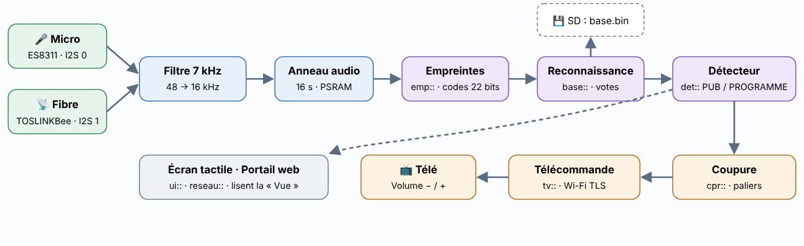

Le son (micro ou fibre) est ramené à 16 kHz. Toutes les 32 ms, une transformée de Fourier donne les fréquences
présentes ; les pics les plus marqués forment, deux par deux, des **codes** de 22 bits. Chaque code entendu est
cherché dans la bibliothèque : si des dizaines de codes désignent la même publicité **avec le même décalage de
temps**, elle est reconnue. La coupure du son et sa remontée par paliers sont ensuite décidées seconde par seconde.

Tous les détails, avec le code, sont dans `docs/programme_explique_v0.9.66.html` (à ouvrir dans un navigateur).

## Licence

MIT (voir `LICENSE`). Composants tiers : QR Code generator (Project Nayuki, MIT), police Inter (SIL OFL 1.1).
